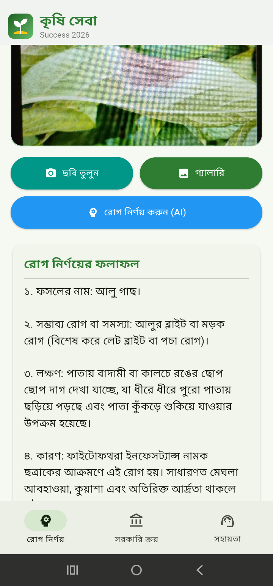
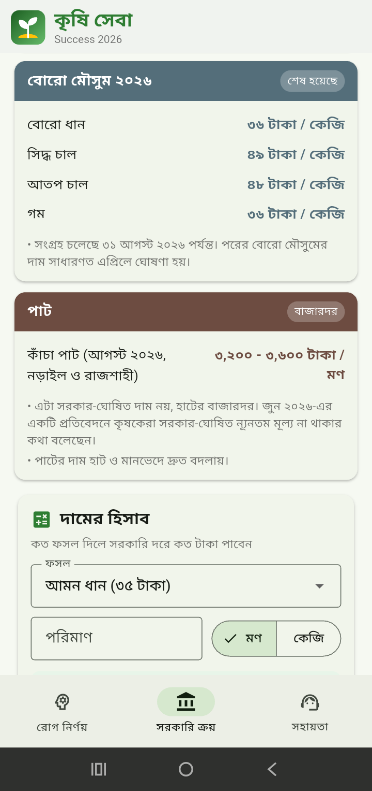

# কৃষি সেবা (Krishi Seba) 🌱

**AI-powered crop disease diagnosis and farmer's helper app for Bangladesh, in Bengali.**
Built with Flutter for the *Success 2026* competition.

কৃষক ফসলের রোগাক্রান্ত পাতা বা গাছের ছবি তুললে অ্যাপ বাংলায় রোগের সম্ভাব্য নাম, কারণ ও প্রতিকার জানায়। সাথে আছে সরকারি ক্রয়মূল্যের তালিকা, হিসাবের ক্যালকুলেটর ও সহায়তার তথ্য।

## Features

- **AI রোগ নির্ণয়:** take or pick a photo of a crop, get a Bengali diagnosis and advice (Google Gemini).
- **সরকারি ক্রয়মূল্য:** government procurement prices (Aman, Boro, sugarcane) and jute market rates, updated online without rebuilding the app.
- **দামের ক্যালকুলেটর:** estimate income from a given quantity at the procurement price (Bangla digits, Bangladeshi number format).
- **সহায়তা:** agriculture call center number (16123) and practical tips.
- Retry and model fallback when the AI service is busy.
- Works on Android; also runs in the browser during development.

## How it works

```
Phone app ──► Cloudflare Worker (holds the Gemini API key) ──► Gemini API
    │
    └──► prices.json on GitHub (editable, no app update needed)
```

- The Gemini API key is **not** stored in the app or in this repository. It lives as a secret inside a small Cloudflare Worker (`worker.js`), which only forwards allowed requests.
- Government prices come from a separate public file, `prices.json`. When prices change, only that file is edited. If the device is offline, the app shows built-in prices.

## Tech stack

Flutter (Dart), Material 3, `http`, `image_picker`, Google Gemini API, Cloudflare Workers, GitHub raw hosting for price data.

## Run it yourself

1. Install Flutter and clone this repository.
2. Deploy `worker.js` as a Cloudflare Worker and add your Gemini key as the secret `GEMINI_API_KEY`.
3. Create `env.json` in the project root (this file is git-ignored):
   ```json
   {
     "PROXY_URL": "https://your-worker.workers.dev",
     "PRICES_URL": "https://raw.githubusercontent.com/<user>/<repo>/main/prices.json"
   }
   ```
4. Run:
   ```
   flutter run -d edge --dart-define-from-file=env.json
   ```
5. Build an Android APK:
   ```
   flutter build apk --release --dart-define-from-file=env.json
   ```

## Important note

The AI's diagnosis is a helpful guide, not a replacement for an expert. For serious crop problems, please contact your local Upazila Agriculture Office.

<!--
Add screenshots after uploading images to a `screenshots` folder, then remove this comment markers:


-->

## Author

Mizanur · [GitHub](https://github.com/mdmizanurtdt-web)
